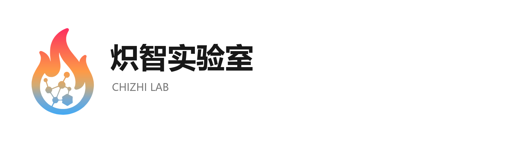
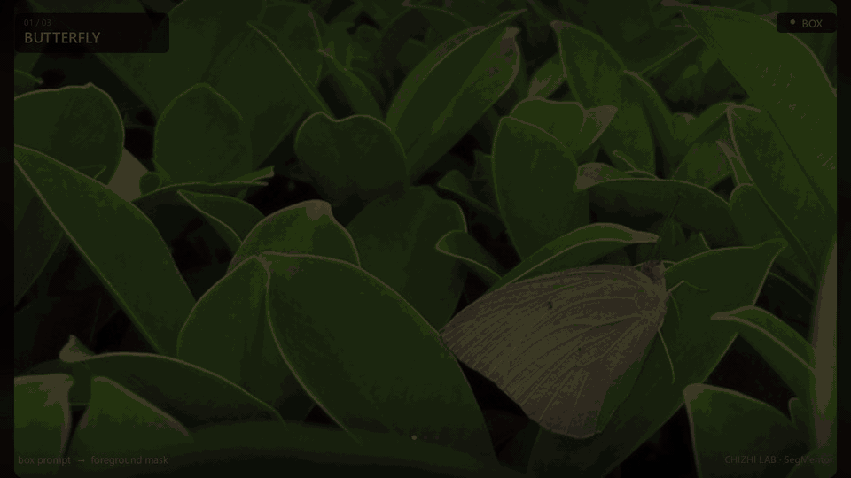
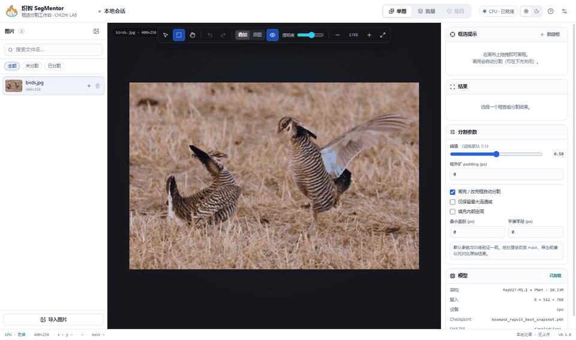
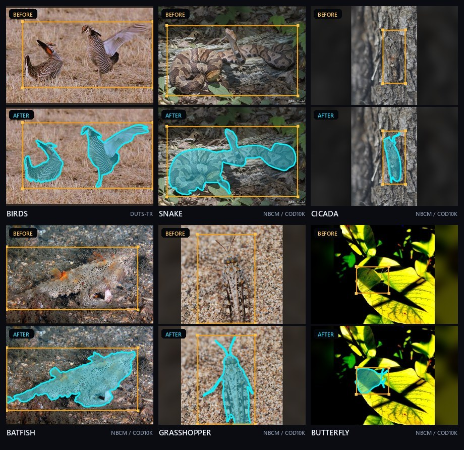
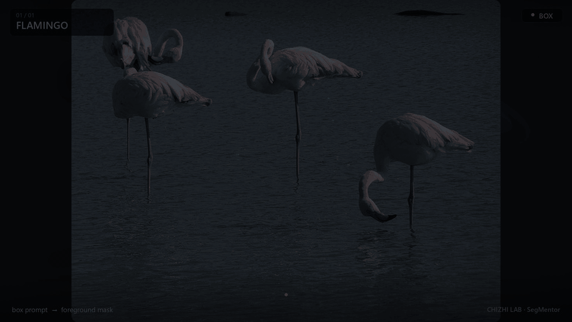
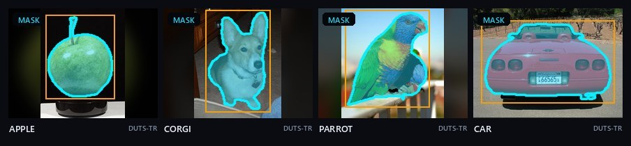
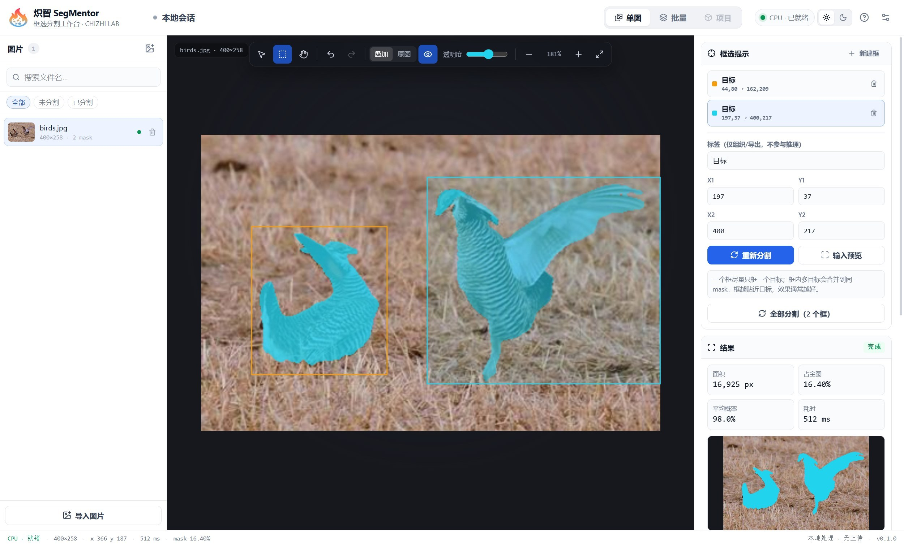
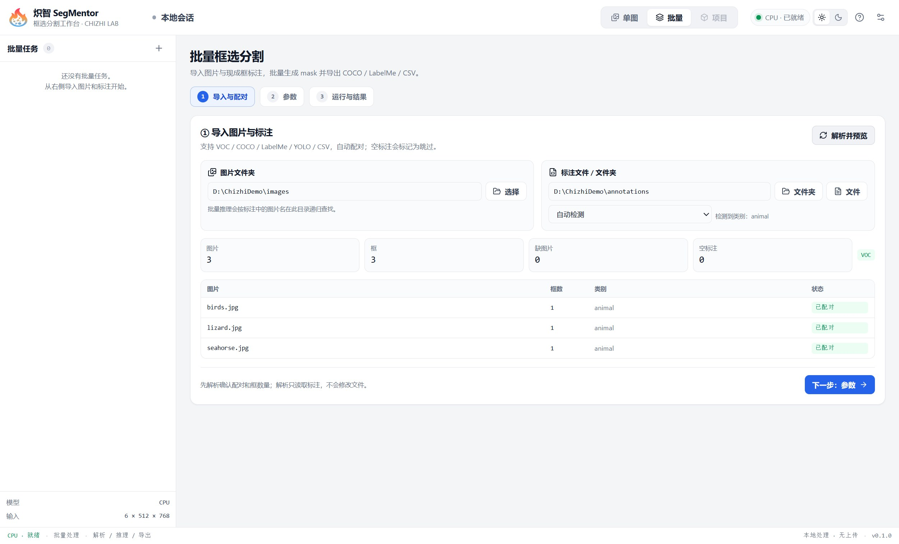
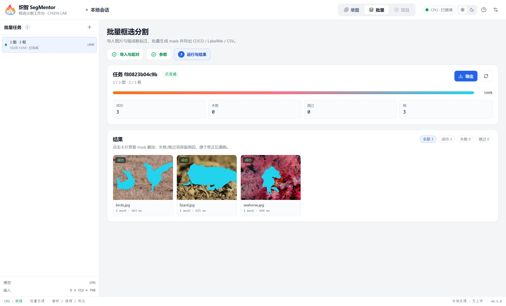
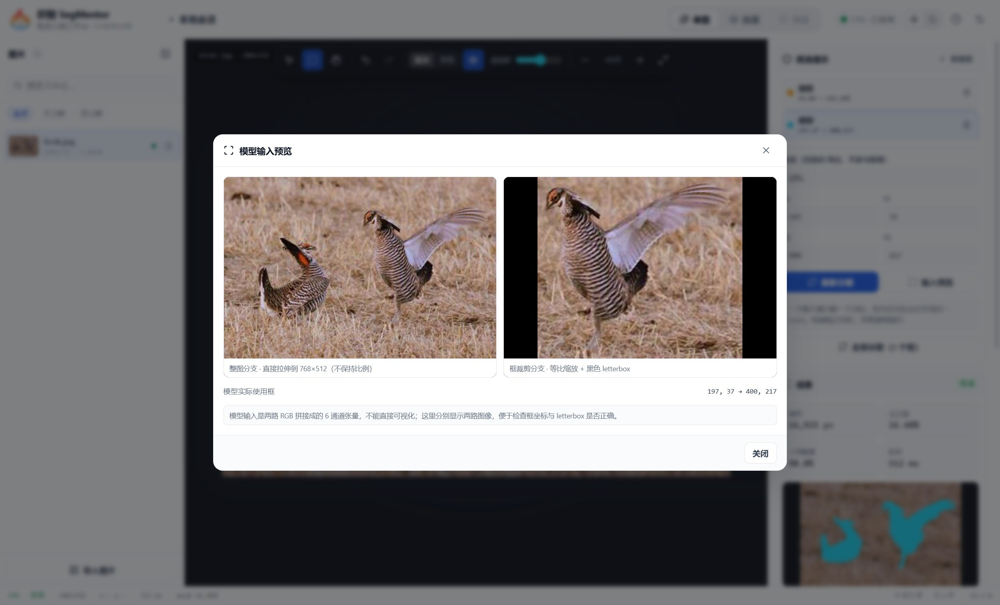

<p align="center">
  <picture>
    <source media="(prefers-color-scheme: dark)" srcset="docs/assets/chizhi-lockup-dark.png">
    
  </picture>
</p>

# 炽智 SegMentor · 框选分割工作台

<p align="center"><strong>简体中文</strong> · <a href="README.en.md">English</a></p>

**炽智实验室 CHIZHI LAB** · 热感知数据基础设施 · 具身智能


炽智 SegMentor 是一个本地运行的桌面工具：导入图片，在画布上拉一个框，模型就会输出框内目标的分割 mask。后端基于 PyTorch，前端是 Electron + React + Konva；图片和推理全部留在本机，无上传、无遥测。

当前仓库处于 **M1 单图 + M2 批量基础版**：模型推理、画布框选、mask 叠加、阈值/后处理、会话恢复，以及 VOC/COCO/LabelMe/YOLO/CSV 批量导入、任务队列、暂停/恢复/重试、COCO/LabelMe/CSV 导出都已打通；PyInstaller sidecar 与 Windows NSIS/portable 安装包也已构建验证。界面中英双语、项目 SQLite/项目页、代码签名/自动更新按计划在后续阶段完成。

<p align="center">
  
</p>

<p align="center"><sub>框选提示 → 前景 mask · Butterfly / Seahorse / Lizard · 模型真实输出（动画为展示节奏，非实时速度）</sub></p>

## 效果演示

### 单图：拉框即分割

真实 Electron 应用录制，不是 mock：导入图片 → 鼠标拉框 → 自动推理 → 叠加/原图切换。示例为 400×258 的双鸟图片：两个框分别框住两只草原松鸡，分别推理；CPU 单次约 0.6 秒。

<p align="center">
  
</p>

### 伪装目标 / 多目标

上排是原图 + 框，下排是模型输出的 mask 叠加与轮廓。示例来自 NBCM/COD10K 与 DUTS-TR（双鸟），全部为模型真实推理结果，未手工修图。

<p align="center">
  
</p>

### 多目标：一框覆盖多只

一个框覆盖三只火烈鸟，模型仍然输出三块独立的 mask。这是刻意的多目标压力测试；精细使用仍建议一个目标一个框。

<p align="center">
  
</p>

### 通用目标

模型并不是只针对伪装目标。下面是 DUTS-TR 的苹果、柯基、鹦鹉、汽车样例：

<p align="center">
  
</p>

> 示例图片版权与使用条款归 NBCM/COD10K、DUTS-TR 原数据集及 Pixabay 图库，**不按 Apache-2.0 授权**；项目作者已确认这些示例可用于本仓库公开演示。来源与替换说明见 [docs/images/DATASETS.md](docs/images/DATASETS.md)；二次再分发请继续遵守原数据集/图库条款。

## 功能（当前）

**单图工作台**

- 导入图片（文件 / 文件夹拖拽 / 多选），支持中文路径、EXIF 方向。
- 画布画框、移动、缩放、数值微调、多框管理、撤销/重做；画完自动分割。
- mask 叠加 / 原图切换、透明度滑杆、结果面积/平均概率/耗时。
- 阈值、框外扩 padding、最大连通域、填洞、平滑等后处理。
- 模型输入预览：并排显示“整图拉伸分支”和“框裁剪 letterbox 分支”。
- 模型加载/切换、设备选择、SHA256 展示；本地 FastAPI sidecar + 会话 token。
- 会话自动恢复（图片路径、框、参数）；mask 结果需重新分割。

**批量工作台**

- 标注自动检测：Pascal VOC XML、COCO JSON、LabelMe JSON、YOLO txt、CSV/通用 JSON 坐标。
- 图片-标注配对预览、缺失图片/空标注提示、类别过滤、跳过无框图。
- 批量任务队列、实时进度、暂停/恢复/取消、失败重试、任务清单持久化。
- 结果网格与 mask 叠加详情；PNG / overlay / COCO 实例分割 / LabelMe polygon / CSV 导出。
- 任务历史，可在应用重启后从清单恢复并继续。

计划中：界面中英双语、项目 SQLite/项目页、代码签名与自动更新、CLI、mask 画笔（v1.1）、SSE 推送。

## 界面

单图工作台：左图片列表、中 Konva 画布、右框/参数/结果检查器。



批量工作台：三步向导（导入配对 → 参数 → 运行结果），支持结果网格与多格式导出。




## 模型

默认读取：

```text
models/boxmask_repvit_best_snapshot.pth
```

- 架构：RepViT-M1.1 + PNet 解码器，约 10.33M 参数。
- 训练数据：SA-1B + pnet_data（COD / SOD / DIS，排除 COCONUT）；类别无关的前景分割。
- 输入：固定 `6 × 512 × 768`（前 3 通道整图拉伸，后 3 通道框裁剪 letterbox）。
- 输出：`net(x)[4]` 单通道 logits，sigmoid + 0.5 阈值；概率图双线性回原图后导出。
- 该快照来自 `model6ch/runs/repvit_pnet/best.pth`（epoch 30，验证 MAE 0.02517 / IoU 0.83954，验证框来自 GT mask 外接框）。
- SHA256：`17b8f2d5fc0e65b1d6ec1b0c8ec123452fba02e4ba4dc784c95d4ed288f82d4c`
- 权重不进入 git，正式发布通过 GitHub Release 附件或下载脚本分发。更多信息见 [models/MODEL_CARD.md](models/MODEL_CARD.md)。

> 模型是**框内前景二分类**，label 只用于组织和导出，不参与推理；一个框尽量只框一个目标。

模型输入预览（整图拉伸分支 + 框裁剪 letterbox 分支）：



## 验证状态（2026-10-28）

- 6 通道输入 + 512×768 raw logits 与训练仓库逐 bit 一致：`max_abs=0.0`。
- 后端测试：21 项（17 项无外部数据依赖；另有 4 项真实数据测试，设置 `BOXMASK_TANK_DATA` / `BOXMASK_TANK_SELECTED` 后全部通过）。
- 真实 `tank_annotated` 全量批量：252/252 张完成，0 失败，CPU 约 `1.04 img/s`（约 242s）。
- 打包后的 sidecar、打包后的单图/批量 UI、COCO/LabelMe/CSV 导出均通过冒烟。
- Windows NSIS 305MB / portable 283MB 安装包已本地构建；未签名，未做干净机器安装测试。
- README demo 的输入框主要来自 GT mask/目标外接框并外扩约 2–3%；火烈鸟是手工覆盖三只的多目标框。仅用于展示，手绘框鲁棒性仍需独立评测。

## 快速开始（开发）

要求：Windows 10/11、Python 3.12、Node.js 22+、npm。

```bash
# 1) Python 环境（uv 会自动下载 Python 3.12）
pip install --user uv
uv sync --extra dev

# 2) 前端依赖
npm install

# 3) 浏览器开发模式：API 8765 + Vite 5173
npm run dev
# 打开 http://127.0.0.1:5173

# 4) Electron 开发模式：Electron 自动拉起 Python sidecar + Vite
npm run dev:desktop

# 5) 生产预览：构建前端，由 FastAPI 托管，Electron 加载本地端口
npm run preview
```

首次启动如果模型未加载，可在右上角“设置”中选择 checkpoint，或点击右侧“加载默认模型”。

## Windows 安装包

```bash
npm run build:web
.venv/Scripts/python.exe scripts/build_backend.py
npm run dist
```

产物在 `release/`：

- `Chizhi-SegMentor-Setup-0.1.0.exe`（NSIS，约 305MB）
- `Chizhi-SegMentor-0.1.0-portable.exe`（便携版）
- `win-unpacked/ChizhiSegMentor.exe`（免安装目录）

当前本地构建包含冻结的 39.8MB 模型权重；开源 Release 也可以发布不带权重的版本，由用户首次启动选择 checkpoint。安装包未签名，Windows SmartScreen 会提示；详见 [docs/packaging.md](docs/packaging.md)。

## 目录

```text
apps/web/                 React + Konva 前端
apps/desktop/             Electron main / preload
backend/boxmask/          FastAPI、推理、mask 工具
backend/boxmask/vendor/   vendored RepViT/RepViTPNet 推理代码
models/                   权重快照 + 模型卡（权重不入 git）
scripts/                  parity_check.py 等开发脚本
docs/                     架构、格式、FAQ、demo 图片
```

## 数值一致性

M0 的验收门槛是与训练仓库的前向结果逐像素一致。运行：

```bash
.venv/Scripts/python.exe scripts/parity_check.py
```

脚本会用同一张真实图片 + VOC 框，对比预处理后的 6 通道张量和 512×768 raw logits，并把 golden `.npy` 写入 `backend/tests/fixtures/`。

## 文档

- [English README](README.en.md)
- [架构与数据流](docs/architecture.md)
- [标注格式](docs/annotation-formats.md)
- [开发指南](docs/development.md)
- [打包与模型分发](docs/packaging.md)
- [常见问题](docs/troubleshooting.md)
- [品牌素材与许可](docs/assets/README.md)
- [示例图片版权](docs/images/DATASETS.md)

## 引用 / Citation

本项目的 6 通道 box-prompted 分割模型与训练思路参考了：

**Jin Zhang, Ruiheng Zhang, Yanjiao Shi, Zhe Cao, Nian Liu, Fahad Shahbaz Khan. “Learning Camouflaged Object Detection from Noisy Pseudo Label.” ECCV 2024, pp. 158–174.**  
DOI: [10.1007/978-3-031-73232-4_9](https://doi.org/10.1007/978-3-031-73232-4_9)

```bibtex
@InProceedings{10.1007/978-3-031-73232-4_9,
  author    = {Zhang, Jin and Zhang, Ruiheng and Shi, Yanjiao and Cao, Zhe and Liu, Nian and Khan, Fahad Shahbaz},
  editor    = {Leonardis, Ale{\v{s}} and Ricci, Elisa and Roth, Stefan and Russakovsky, Olga and Sattler, Torsten and Varol, G{\"u}l},
  title     = {Learning Camouflaged Object Detection from Noisy Pseudo Label},
  booktitle = {Computer Vision -- ECCV 2024},
  year      = {2025},
  publisher = {Springer Nature Switzerland},
  address   = {Cham},
  pages     = {158--174},
  isbn      = {978-3-031-73232-4},
  doi       = {10.1007/978-3-031-73232-4_9}
}
```

## 品牌

炽智 SegMentor 由**炽智实验室（CHIZHI LAB）**开发。实验室标识、名称与 lockup 归炽智实验室所有，**不在 Apache-2.0 授权范围内**；再分发或二次开发时请保留 README 顶部的实验室标识与名称。素材说明见 [docs/assets/README.md](docs/assets/README.md)。

## 隐私与许可

- 图片、mask、模型全部在本机；运行时无网络请求（只有用户主动下载模型时才访问 Release）。
- 代码 Apache-2.0，见 [LICENSE](LICENSE)；vendored RepViT 同为 Apache-2.0，见 [backend/boxmask/vendor/REPVIT_LICENSE](backend/boxmask/vendor/REPVIT_LICENSE)。
- 模型权重与训练数据的许可见模型卡；README 示例图片的版权见 [docs/images/DATASETS.md](docs/images/DATASETS.md)。公开分发前请确认训练数据与示例图片的再分发许可。

<p align="center"><sub>炽智实验室 CHIZHI LAB · 炽智 SegMentor</sub></p>
